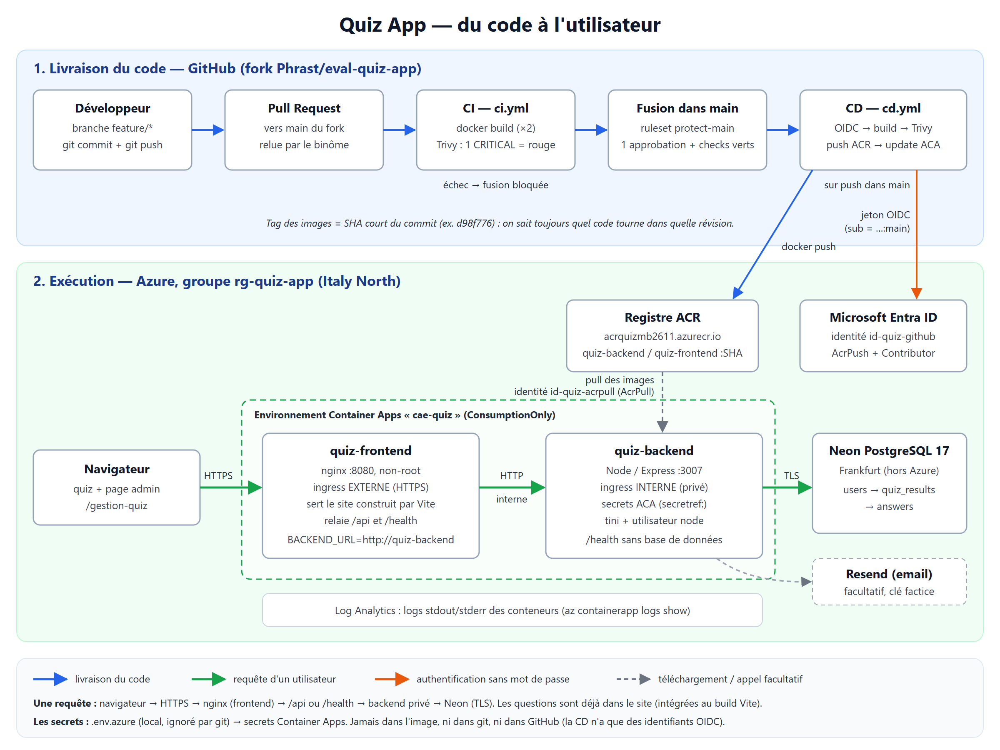

# Quiz App - Projet d'évaluation Conteneurisation

## Mission

Vous intégrez une équipe DevOps chargée de **conteneuriser, sécuriser et déployer** l'application **Quiz App** sur Microsoft Azure, puis d'automatiser ses livraisons.

Le **code applicatif est fourni**. Votre mission concerne la conteneurisation, l'exploitation, la sécurité et le déploiement ; **ne modifiez pas la logique métier**. Une modification ciblée d'une question de quiz présente dans le code servira à démontrer le processus de livraison.

L'application comporte un frontend, un backend et une base PostgreSQL. Elle peut utiliser un service d'envoi d'emails ; les fonctionnalités qui en dépendent doivent être configurées uniquement si les accès nécessaires sont fournis.

## Résultat attendu

1. Faire fonctionner Quiz App localement avec Docker, Docker Compose et PostgreSQL persistant.
2. Construire des images sécurisées, analyser les vulnérabilités et documenter les corrections.
3. Déployer les images via Azure Container Registry (ACR) sur Azure Container Apps avec Azure CLI.
4. Connecter le backend à un PostgreSQL externe (Neon recommandé, ou solution compatible).
5. Mettre en place une CI/CD avec **GitHub Actions (recommandé)** ou **GitLab CI/CD (autorisé)** : contrôles sur Pull/Merge Request, scan Trivy bloquant, puis publication et déploiement après fusion dans `main`.
6. Présenter le travail et les preuves de chaque jalon lors d'une soutenance.

Les jalons sont validés progressivement. Une difficulté sur PostgreSQL cloud n'annule pas les jalons déjà acquis et n'interdit pas de démontrer la partie CI/CD technique.

## Travail à partir du dépôt officiel

Le formateur publie le code de départ et les consignes sur la branche `main` de son dépôt **de référence**. **Chaque groupe crée un fork de ce dépôt sur GitHub**, puis travaille exclusivement dans son fork. Les branches `feature/*` et les Pull Requests doivent cibler **`main` du fork du groupe**, jamais `main` du formateur.

- Sur GitHub : faites un fork **par groupe**, activez GitHub Actions si nécessaire et configurez vos propres secrets et autorisations Azure. Les secrets du dépôt d’origine ne sont pas transmis au fork.
- Sur GitLab (alternative admise) : créez un projet de groupe à partir du code de départ et utilisez des **Merge Requests dirigées vers `main` de votre projet**, pas vers le dépôt officiel.
- Aucun accès en écriture au dépôt du formateur n’est nécessaire. Transmettez au formateur l’URL de votre dépôt de groupe.

## Commencer

Lisez les documents dans cet ordre :

- [Présentation du projet](docs/01-presentation-projet.md)
- [Consignes techniques](docs/02-consignes-techniques.md)
- [Jalons et validations](docs/03-jalons-validation.md)
- [Exigences CI/CD](docs/04-pipeline-cicd.md)
- [Fonctionnalités avancées](docs/05-bonus-azure.md)
- [Soutenance et livrables](docs/06-soutenance-livrables.md)
- [Ressources officielles](docs/07-ressources.md)
- [Documentation technique de Quiz App : ports, API et configuration](docs/08-documentation-technique.md)
- [Utilisation responsable de l’IA](docs/09-utilisation-ia.md)

**Important :** les comptes Azure for Students peuvent être limités par les crédits, quotas, régions et autorisations. Vérifiez les possibilités de votre abonnement avant de créer des ressources payantes. Supprimez les ressources inutilisées après sauvegarde des preuves et accord du formateur.

## Règles générales

- Travail en groupe ; déposez le lien de votre dépôt et les preuves demandées au formateur.
- Versionnez les fichiers de configuration, les scripts et les workflows **que vous produisez**.
- Ne commitez jamais de mots de passe, URL PostgreSQL contenant des identifiants, clés API, secrets GitHub/GitLab ou fichiers `.env` réels.
- Une démonstration validée reste acquise même si les ressources cloud sont supprimées ensuite.

---

# Rendu du groupe

**Groupe :** Nicolas ([Phrast](https://github.com/Phrast)) · Mathis ([vic0m](https://github.com/vic0m))

**Application en ligne** (tant que les ressources Azure existent) : https://quiz-frontend.politeplant-23b538ef.italynorth.azurecontainerapps.io

## Architecture

- **Locale** (Docker Compose) : schéma et analyse dans [docs/rendu/01-analyse.md](docs/rendu/01-analyse.md).
- **Cloud et chaîne de livraison** :

## Utilisation

| Besoin | Où / commande |
|---|---|
| Lancer en local | [docs/rendu/02-lancement-local.md](docs/rendu/02-lancement-local.md) : `cp .env.example .env`, puis `docker compose up -d --build`, puis ouvrir http://localhost:8087 |
| Déployer sur Azure (prérequis, variables, vérifications) | [docs/rendu/04-deploiement-azure.md](docs/rendu/04-deploiement-azure.md) : `bash scripts/deploy.sh` |
| Configurer la CD (identité OIDC) | `bash scripts/setup-github-oidc.sh`, puis les secrets et variables GitHub ([preuve J6-B](preuves/J6/03-cd-apres-fusion.md)) |
| Tout supprimer | `bash scripts/destroy.sh` supprime tout le groupe de ressources ; la base Neon se supprime depuis sa console |
| CI / CD | [ci.yml](.github/workflows/ci.yml) sur chaque PR · [cd.yml](.github/workflows/cd.yml) après chaque fusion dans `main` |

## Jalons et preuves

| Jalon | Preuves | PR |
|---|---|---|
| J0 — Abonnements Azure | [verification-azure.md](preuves/J0/verification-azure.md) | [#2](https://github.com/Phrast/eval-quiz-app/pull/2), [#3](https://github.com/Phrast/eval-quiz-app/pull/3) |
| J1 — Conteneurisation locale | [analyse](docs/rendu/01-analyse.md), [preuve](preuves/J1/01-conteneurisation-locale.md) | [#4](https://github.com/Phrast/eval-quiz-app/pull/4), [#5](https://github.com/Phrast/eval-quiz-app/pull/5) |
| J2 — Sécurité des images | [rapport Trivy avant/après](preuves/J2/01-securite-images.md) | [#6](https://github.com/Phrast/eval-quiz-app/pull/6) |
| J3 — Azure CLI et ACR | [preuve](preuves/J3/01-acr-images.md) | [#7](https://github.com/Phrast/eval-quiz-app/pull/7), [#9](https://github.com/Phrast/eval-quiz-app/pull/9), [#14](https://github.com/Phrast/eval-quiz-app/pull/14) |
| J4 — Azure Container Apps | [preuve](preuves/J4/01-deploiement-aca.md), [diagnostic](preuves/J4/diagnostic.md) | [#10](https://github.com/Phrast/eval-quiz-app/pull/10), [#11](https://github.com/Phrast/eval-quiz-app/pull/11) |
| J5 — PostgreSQL cloud (Neon) | [section Neon](docs/rendu/04-deploiement-azure.md), [captures](preuves/J5/) | [#18](https://github.com/Phrast/eval-quiz-app/pull/18) |
| J6 — Protection de `main` | [preuve](preuves/J6/01-protection-main.md) | [#1](https://github.com/Phrast/eval-quiz-app/pull/1) |
| J6-A — CI sur les PR | [preuve](preuves/J6/02-ci-pull-request.md), démonstration d'échec : [#12](https://github.com/Phrast/eval-quiz-app/pull/12) | [#8](https://github.com/Phrast/eval-quiz-app/pull/8), [#13](https://github.com/Phrast/eval-quiz-app/pull/13) |
| J6-B — CD après fusion | [preuve](preuves/J6/03-cd-apres-fusion.md) | [#15](https://github.com/Phrast/eval-quiz-app/pull/15), [#16](https://github.com/Phrast/eval-quiz-app/pull/16), [#17](https://github.com/Phrast/eval-quiz-app/pull/17), [#19](https://github.com/Phrast/eval-quiz-app/pull/19) |
| Démonstration complète | question modifiée → PR → CI → approbation → fusion → ACR → Container Apps | [#20](https://github.com/Phrast/eval-quiz-app/pull/20) |

## Usage de l'IA

- **Outil :** Claude Code, un assistant IA intégré à VS Code.
- **Tâches assistées :** plan de travail et explications (Docker, Azure, GitHub Actions), propositions de configuration (Dockerfiles, `docker-compose.yml`, nginx, workflows), aide au diagnostic d'erreurs et à la rédaction des documents de rendu.
- **Vérification :** tout a été exécuté et testé par le binôme (terminal WSL) ou directement dans les outils Azure, Neon, Resend et GitHub, puis relu en binôme avant fusion.
- **Confidentialité :** aucun mot de passe, clé API ni chaîne de connexion n'a été transmis à l'IA.
