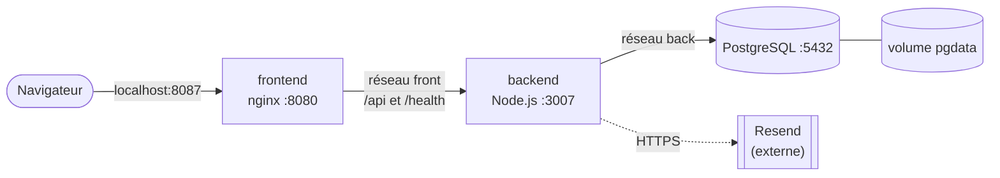

# Analyse préalable — Quiz App (J1)

## 1. Composants

| Composant | Rôle | Dépend de |
|---|---|---|
| Frontend (HTML/JS/CSS, construit avec Vite) | pages du quiz et de l'administration | backend (appels vers `/api`) |
| nginx | sert le frontend construit, relaie `/api` et `/health` vers le backend | backend |
| Backend (Node.js / Express) | API : inscription, résultats, administration | PostgreSQL, Resend |
| PostgreSQL | stocke les utilisateurs et les résultats | volume de données |
| Resend (service externe) | envoi des résultats par email (optionnel) | clé API |

## 2. Ports

| Service | Port | Exposé sur l'hôte |
|---|---|---|
| Vite | 5173 | non (développement uniquement) |
| frontend (nginx) | 8080 | **oui, sur 8087** : seul point d'entrée |
| backend | 3007 | non : joint par nginx |
| PostgreSQL | 5432 | non : joint par le backend |

## 3. Variables

| Variable | Type |
|---|---|
| `POSTGRES_USER`, `POSTGRES_DB` | public |
| `POSTGRES_PASSWORD` | secret |
| `DATABASE_URL` | secret (contient le mot de passe) |
| `RESEND_API_KEY` | secret (ne doit pas être vide, sinon le backend ne démarre pas) |
| `FROM_EMAIL`, `ADMIN_USERNAME` | public |
| `ADMIN_PASSWORD`, `JWT_SECRET` | secret |
| `BACKEND_URL` (ajoutée pour nginx) | public |

Les secrets sont dans `.env`, qui n'est pas versionné. `.env.example` liste les variables avec des valeurs fictives.

## 4. Routes de test

| Route | Usage |
|---|---|
| `GET /health` | santé du backend : `200 {"status":"ok"}`, sans interroger la base |
| `POST /api/users` | inscription : teste le backend et la base |
| `POST /api/results` | enregistrement d'un résultat : teste le backend et la base |
| `POST /api/admin/login` puis `GET /api/admin/results` | lecture des résultats enregistrés (persistance) |

## 5. Questionnaires et résultats

- **Questions** : fichiers `questions_<sujet>.js` à la racine. Elles sont intégrées au **build** du frontend : modifier une question oblige à reconstruire l'image frontend.
- **Résultats** : stockés dans PostgreSQL, dans les tables `users`, `quiz_results` et `answers`, créées par `database/init.sql`.

## 6. Schéma d'architecture locale

## 7. Choix de conteneurisation et de persistance

| Choix | Pourquoi |
|---|---|
| 3 services : `frontend`, `backend`, `db` | un processus par conteneur |
| Frontend construit en plusieurs étapes | Node sert à construire le site ; l'image finale ne contient que nginx et les fichiers statiques |
| nginx comme seul point d'entrée | le frontend appelle `/api` : nginx le relaie, et le backend et la base ne sont pas exposés |
| 2 réseaux : `front` (frontend ↔ backend) et `back` (backend ↔ base) | le frontend ne peut pas joindre la base |
| Image officielle `postgres` + `init.sql` dans `/docker-entrypoint-initdb.d/` | le schéma est créé automatiquement au premier démarrage |
| Volume nommé `pgdata` sur `/var/lib/postgresql/data` | les données survivent à la recréation des conteneurs ; seul `docker compose down -v` les supprime |
| Healthchecks + `depends_on` | démarrage dans l'ordre : base, puis backend, puis nginx |
