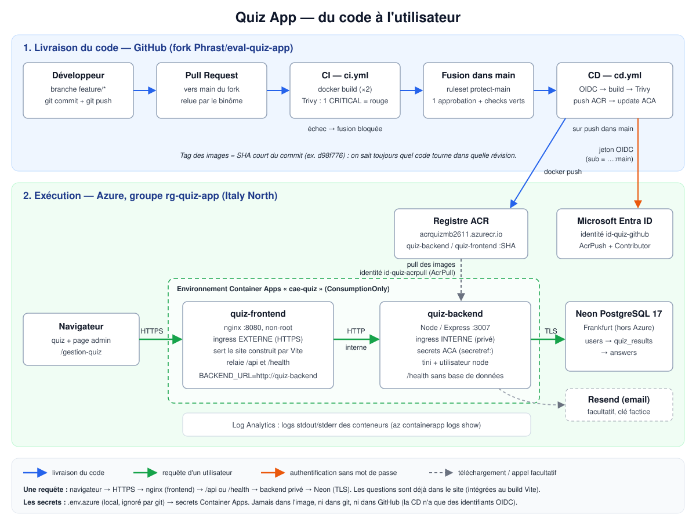
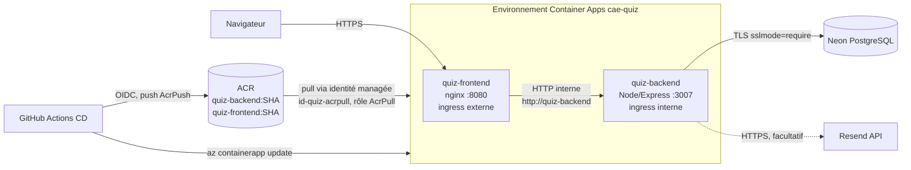

# 04 — Déploiement Azure (J3, J4, J5)

> Déploiement réalisé par M2 (Mathis) avec **Azure CLI** et des scripts bash, dans son abonnement Azure for Students, région **`italynorth`** (décision J0).

| Élément | Nom |
|---|---|
| Groupe de ressources | `rg-quiz-app` |
| Registre | `acrquizmb2611` (`acrquizmb2611.azurecr.io`) |
| Environnement | `cae-quiz` (mode **ConsumptionOnly**) |
| Applications | `quiz-backend` (interne), `quiz-frontend` (externe) |
| Identité de pull | `id-quiz-acrpull` (rôle AcrPull sur l'ACR) |
| URL publique | `https://quiz-frontend.politeplant-23b538ef.italynorth.azurecontainerapps.io` |

## Vue d'ensemble : du code à l'utilisateur



Version PNG pour les diapositives : [schema-quiz-app.png](schema-quiz-app.png).

## Architecture cloud



## Prérequis

- Terminal **WSL (Ubuntu)** ou Linux, avec Docker Desktop démarré et l'intégration WSL activée.
- Azure CLI dans WSL + extension `containerapp` ; `az login --use-device-code` fait.
- Rôle **Owner** sur l'abonnement (nécessaire pour attribuer AcrPull / AcrPush).
- Dockerfiles fusionnés dans `main` (`Dockerfile` à la racine, `backend/Dockerfile`).

## Fichiers

| Fichier | Versionné | Contenu |
|---|---|---|
| `scripts/config.sh` | oui | Paramètres non sensibles : groupe, région, noms de l'ACR, de l'environnement et des apps, tag |
| `.env.azure.example` | oui | Liste des secrets attendus, valeurs fictives |
| `.env.azure` | **non** (`.gitignore`) | Les vrais secrets (`DATABASE_URL`, `JWT_SECRET`, `ADMIN_PASSWORD`, `RESEND_API_KEY`) |
| `scripts/deploy.sh` | oui | Création / mise à jour idempotente de toutes les ressources |
| `scripts/destroy.sh` | oui | Suppression du groupe de ressources, avec confirmation |
| `scripts/setup-github-oidc.sh` | oui (J6, étape 10) | Identité de la CD GitHub Actions (OIDC), lancée une seule fois |

## Variables

| Variable | Où | Nature |
|---|---|---|
| `DATABASE_URL` | secret ACA `database-url` | secrète |
| `JWT_SECRET` | secret ACA `jwt-secret` | secrète |
| `ADMIN_PASSWORD` | secret ACA `admin-password` | secrète |
| `RESEND_API_KEY` | secret ACA `resend-api-key` (valeur factice si pas de clé) | secrète |
| `ADMIN_USERNAME`, `FROM_EMAIL` | variables d'environnement du backend | publiques |
| `BACKEND_URL=http://quiz-backend` | variable d'environnement du frontend (template nginx) | publique |

Les variables secrètes sont référencées par `secretref:<nom>` : elles ne sont ni dans l'image, ni dans git, ni dans GitHub.

## Lancement

```bash
cp .env.azure.example .env.azure     # puis remplir (openssl rand -hex 32 pour JWT_SECRET)
git check-ignore -v .env.azure       # doit afficher la règle qui l'ignore
bash scripts/deploy.sh               # premier déploiement
bash scripts/deploy.sh               # deuxième exécution : aucune erreur (idempotence)
```

Ce que fait `deploy.sh`, dans l'ordre :
1. groupe `rg-quiz-app` ;
2. ACR Basic sans compte admin ;
3. build **local** des deux images, tag = SHA court du commit, push dans l'ACR ;
4. environnement Container Apps en mode **ConsumptionOnly** (crée aussi Log Analytics). Le mode est imposé : les versions récentes de l'extension créent sinon un environnement *Express*, qui refuse `--allow-insecure` ;
5. identité managée `id-quiz-acrpull` avec le rôle **AcrPull limité à l'ACR** ;
6. backend : ingress **interne**, port 3007, secrets, `--allow-insecure` (nginx lui parle en HTTP) ;
7. frontend : ingress **externe** HTTPS, port 8080, `BACKEND_URL=http://quiz-backend`.

Le backend est déployé **avant** le frontend, car nginx résout `quiz-backend` au démarrage.

## Vérifications

```bash
FQDN=$(az containerapp show -n quiz-frontend -g rg-quiz-app --query properties.configuration.ingress.fqdn -o tsv)
curl -i https://$FQDN/health                                           # 200 {"status":"ok"}
az containerapp revision list -n quiz-backend  -g rg-quiz-app -o table
az containerapp revision list -n quiz-frontend -g rg-quiz-app -o table
az containerapp logs show -n quiz-backend -g rg-quiz-app --tail 50
az acr repository show-tags -n <ACR_NAME> --repository quiz-backend -o table
```

## PostgreSQL cloud (Neon, J5)

1. Projet Neon `quiz-app`, PostgreSQL 17, région Frankfurt.
2. Schéma : `database/init.sql` exécuté **une fois** dans le *SQL Editor* de Neon.
3. Chaîne de connexion avec `?sslmode=require` copiée uniquement dans `.env.azure`.
4. `bash scripts/deploy.sh` met à jour le secret, puis redémarrage de la révision du backend (un changement de secret ne crée pas de révision) :
   ```bash
   REV=$(az containerapp show -n quiz-backend -g rg-quiz-app --query properties.latestRevisionName -o tsv)
   az containerapp revision restart -n quiz-backend -g rg-quiz-app --revision "$REV"
   ```

## Résultats obtenus

| Jalon | Date | Résultat | Preuve |
|---|---|---|---|
| J3 : ressources et images ACR | 26/11/2026 | ACR `acrquizmb2611`, dépôts `quiz-backend` et `quiz-frontend`, tags = SHA de commit | [preuves/J3](../../preuves/J3/01-acr-images.md) |
| J4 : `/health` 200 via le frontend | 26/11/2026 | 2 apps `Healthy`, tag `832fb4c`, `/health` = 200, backend injoignable depuis internet | [preuves/J4](../../preuves/J4/01-deploiement-aca.md), [diagnostic](../../preuves/J4/diagnostic.md) |
| J5 : inscription et résultat persistés dans Neon | | | |

**Pièges rencontrés** (détails dans `preuves/J4`) :
- `.env.azure` doit être en LF, et les valeurs avec espaces ou `< >` doivent être entre guillemets, car il est lu par `source` ;
- environnement Express créé par défaut, d'où `--environment-mode ConsumptionOnly` ;
- premier pull refusé dans un environnement neuf : il suffit de relancer.

## Nettoyage

```bash
bash scripts/destroy.sh               # demande de taper le nom du groupe pour confirmer
az group exists -n rg-quiz-app        # false attendu
```
Puis : supprimer le projet Neon depuis sa console et retirer les secrets `AZURE_*` de GitHub.
À faire uniquement après sauvegarde des preuves et accord du formateur.
