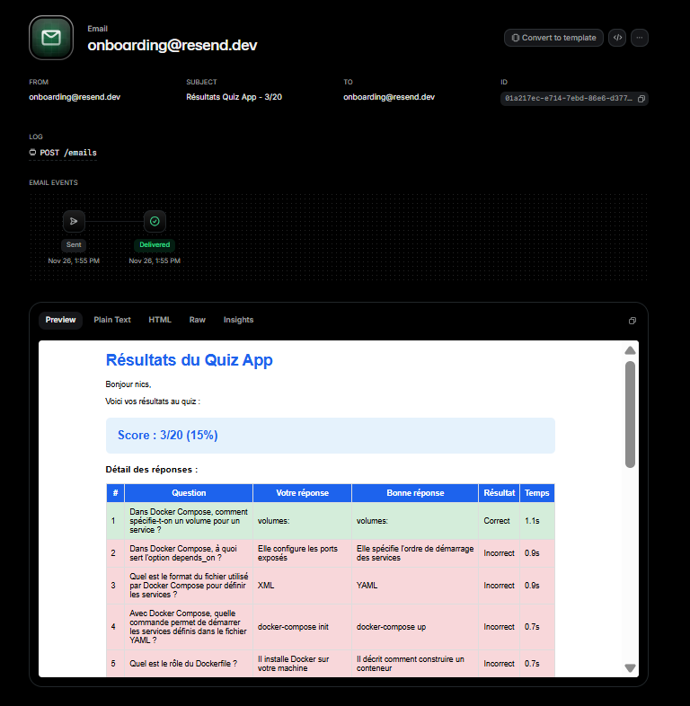
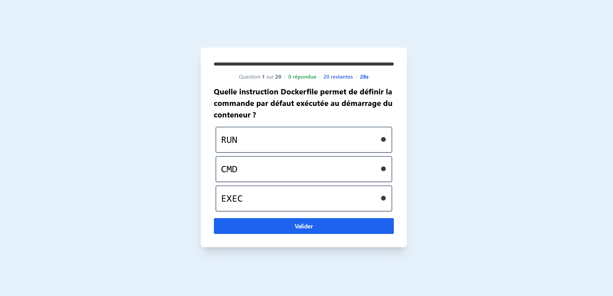
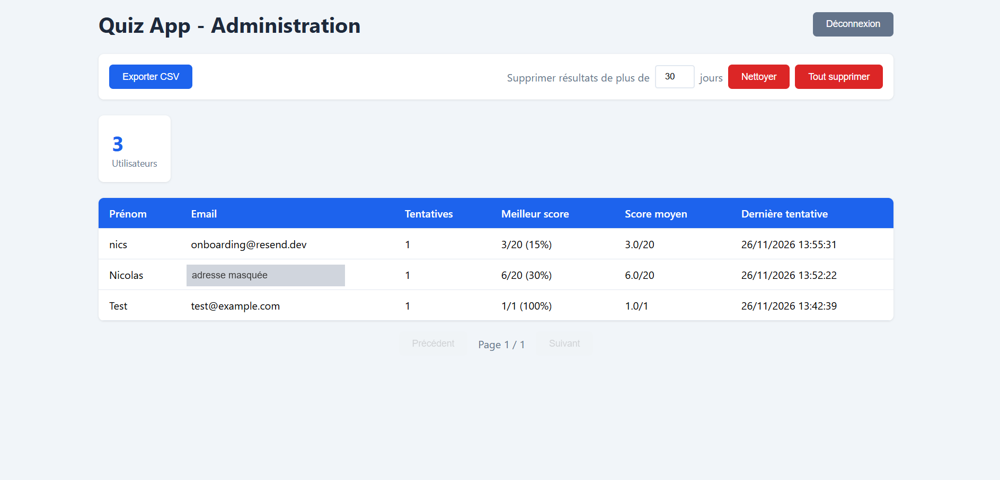

# J1 — Conteneurisation locale

**Date :** 26/11/2026

## Fichiers produits

| Fichier | Rôle |
|---|---|
| `Dockerfile` | image du frontend : construction avec Vite (Node), puis service par nginx |
| `backend/Dockerfile` | image du backend Node.js |
| `nginx/default.conf.template` | configuration nginx ; l'URL du backend est passée par `BACKEND_URL` |
| `docker-compose.yml` | services `frontend`, `backend`, `db`, réseaux `front` et `back`, volume `pgdata` |
| `.dockerignore`, `backend/.dockerignore` | fichiers exclus du contexte de build |
| `backend/package-lock.json` | versions exactes des dépendances du backend |

## Démarrage

```console
$ docker compose up -d --build
$ docker compose ps
SERVICE    IMAGE                 STATUS                    PORTS
backend    quiz-backend:local    Up 51 seconds (healthy)   3007/tcp
db         postgres:17-alpine    Up 57 seconds (healthy)   5432/tcp
frontend   quiz-frontend:local   Up 40 seconds             0.0.0.0:8087->8080/tcp
```

Seul le frontend est publié, sur le port 8087. Le backend et la base ne sont joignables que par les réseaux internes.

## Communication frontend → backend → base

```console
$ curl -i http://localhost:8087/health
HTTP/1.1 200 OK
{"status":"ok"}

$ curl -X POST http://localhost:8087/api/users -H "Content-Type: application/json" \
    -d '{"firstname":"Test","email":"test@example.com"}'
{"id":1,"firstname":"Test","email":"test@example.com"}

$ curl -X POST http://localhost:8087/api/results -H "Content-Type: application/json" -d '{"userId":1, ...}'
{"message":"Results saved and email sent","quizResultId":1}

$ docker compose exec db psql -U quiz_user -d quiz_db \
    -c "SELECT (SELECT count(*) FROM users) AS users, (SELECT count(*) FROM quiz_results) AS quiz_results, (SELECT count(*) FROM answers) AS answers;"
 users | quiz_results | answers
-------+--------------+---------
     1 |            1 |       1
```

Logs du backend (extrait, adresse masquée) :

```console
$ docker compose logs backend
Server running on port 3007
Email sent successfully to <adresse masquée>, id: 01a217ec-e714-7ebd-86e6-d377c889271e
```

Le résultat est enregistré en base, puis l'email de résultats est envoyé via Resend. La clé est dans `.env`, qui n'est pas versionné.







## Persistance après recréation des conteneurs

```console
$ docker compose down
$ docker volume ls --filter name=pgdata
DRIVER    VOLUME NAME
local     eval-quiz-app_pgdata
$ docker compose up -d --wait
$ docker compose up -d --force-recreate --wait
```

| Moment | ID du conteneur `db` | users | quiz_results |
|---|---|---|---|
| Avant `docker compose down` | `a7dfd89329b8` | 1 | 1 |
| Après `down` puis `up` | `f582671a9138` | 1 | 1 |
| Après `up --force-recreate` | `d2328102042b` | 1 | 1 |

**Explication du volume :** les données de PostgreSQL sont stockées dans le volume nommé `eval-quiz-app_pgdata`, monté sur `/var/lib/postgresql/data`.
- Les conteneurs sont recréés (nouvel identifiant à chaque fois), mais le volume est conservé, donc les données restent.
- Seul `docker compose down -v` supprimerait le volume et ses données.
