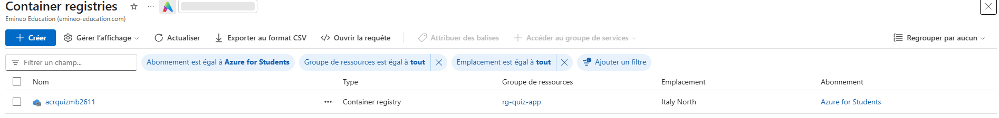
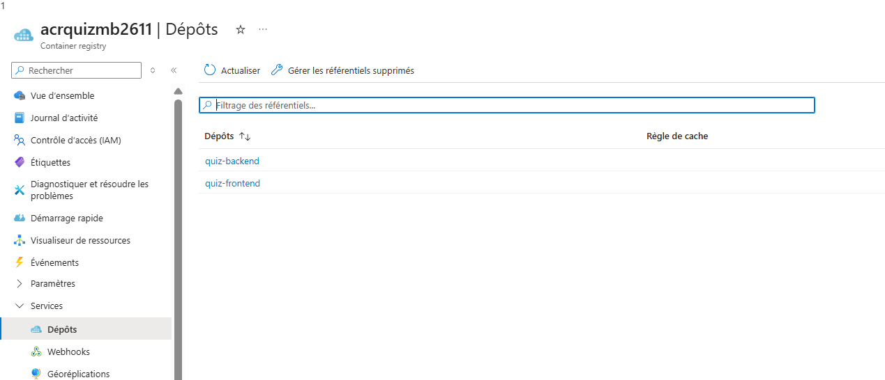
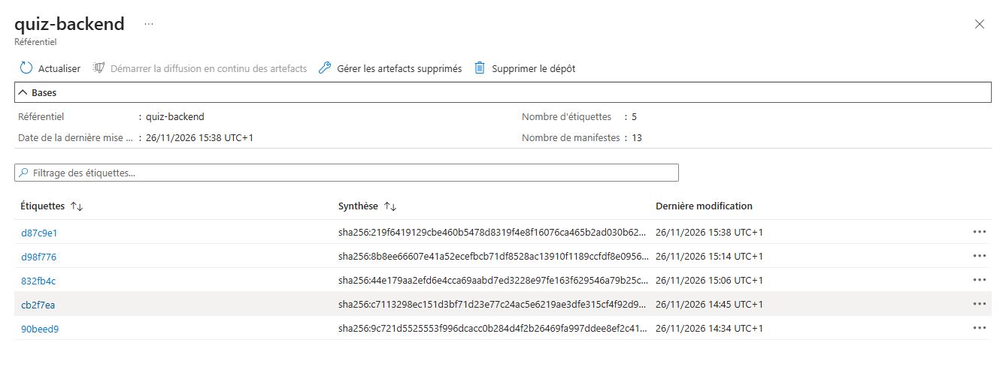
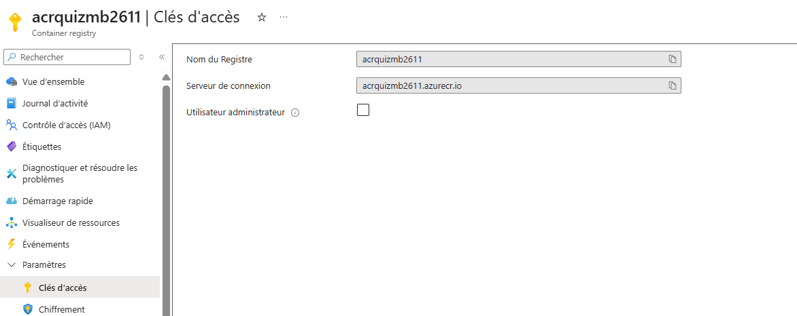

# J3 — Registre ACR et publication des images

**Date :** 26/11/2026
**Abonnement :** abonnement du projet (Mathis), région `italynorth` (décision J0).
**Code publié :** commit `90beed9` de `main` (fusion de la PR #7). Les images sont les **v2 durcies** de J2.

Les identifiants d'abonnement et de tenant n'apparaissent dans aucune des sorties ci-dessous.

---

## 1. Commandes exécutées

Elles correspondent à la partie 1 de [`scripts/deploy.sh`](../../scripts/deploy.sh), tapée une première fois à la main :

```console
$ git switch main && git pull
$ source scripts/config.sh
$ echo "$RG | $LOCATION | $ACR_NAME | $TAG"
rg-quiz-app | italynorth | acrquizmb2611 | 90beed9

$ az group create -n "$RG" -l "$LOCATION" -o table
$ az acr create -n "$ACR_NAME" -g "$RG" --sku Basic --admin-enabled false -o table
$ ACR_SERVER=$(az acr show -n "$ACR_NAME" --query loginServer -o tsv)
$ az acr login -n "$ACR_NAME"
Login Succeeded

$ docker build -t "$ACR_SERVER/quiz-backend:$TAG"  ./backend
$ docker build -t "$ACR_SERVER/quiz-frontend:$TAG" .
$ docker push "$ACR_SERVER/quiz-backend:$TAG"
$ docker push "$ACR_SERVER/quiz-frontend:$TAG"
```

Le build se fait **en local**, puis les images sont poussées avec `docker push`. On n'utilise pas `az acr build` (ACR Tasks), souvent refusé sur les abonnements étudiants.

## 2. Ressources créées

```console
$ az resource list -g rg-quiz-app -o table
Name           ResourceGroup    Location    Type                                    Status
-------------  ---------------  ----------  --------------------------------------  ---------
acrquizmb2611  rg-quiz-app      italynorth  Microsoft.ContainerRegistry/registries  Succeeded

$ az acr show -n acrquizmb2611 --query "{nom:name, serveur:loginServer, sku:sku.name, adminActive:adminUserEnabled, region:location}" -o table
Nom            Serveur                   Sku    AdminActive    Region
-------------  ------------------------  -----  -------------  ----------
acrquizmb2611  acrquizmb2611.azurecr.io  Basic  False          italynorth
```

- **SKU Basic** : l'offre la moins chère (environ 0,17 $/jour), suffisante pour deux dépôts.
- **Compte admin désactivé** (`AdminActive = False`) : le registre n'a pas de couple login/mot de passe. L'accès passe par Entra ID : `az acr login` pour nous, une identité managée avec le rôle AcrPull pour Container Apps (J4), une identité OIDC avec le rôle AcrPush pour la CD (J6).

## 3. Dépôts et tags

```console
$ az acr repository list -n acrquizmb2611 -o table
Result
-------------
quiz-backend
quiz-frontend

$ az acr repository show-tags -n acrquizmb2611 --repository quiz-backend -o table
Result
--------
90beed9

$ az acr repository show-tags -n acrquizmb2611 --repository quiz-frontend -o table
Result
--------
90beed9
```

**Traçabilité :** le tag `90beed9` est le SHA court du commit de `main` dont les images sont issues (`TAG=$(git rev-parse --short=7 HEAD)` dans `scripts/config.sh`). `git show 90beed9` donne donc exactement le code qui tourne.

## 4. Digests (contenu exact)

```console
$ az acr manifest list-metadata -r acrquizmb2611 -n quiz-backend --query "[].{digest:digest, tags:tags[0], cree:createdTime}" -o table
Digest                                                                   Cree                          Tags
-----------------------------------------------------------------------  ----------------------------  -------
sha256:27289ed6e4de8d3c7ccb1afd50c905f50d4e8ccf9b2d14e2c7fc23d527149d34  2026-11-26T13:34:09.6309693Z
sha256:9c721d5525553f996dcacc0b284d4f2b26469fa997ddee8ef2c41acf2db778fd  2026-11-26T13:34:10.1130647Z  90beed9
sha256:bb97478a08687f22725d4b086bc23680e08c368c494e8d0898685b378de8b988  2026-11-26T13:34:09.5858416Z

$ az acr manifest list-metadata -r acrquizmb2611 -n quiz-frontend --query "[].{digest:digest, tags:tags[0], cree:createdTime}" -o table
Digest                                                                   Tags     Cree
-----------------------------------------------------------------------  -------  ----------------------------
sha256:0c1d30fa77722b598e07bb0f682c682552b3be9c2c3d6cfa76b5bc697a49fb4e  90beed9  2026-11-26T13:34:14.5848858Z
sha256:ad88ed639a0587cfe62843190a672b350da501af5cce4d5140c8da54ce7644b8           2026-11-26T13:34:13.9352814Z
sha256:b0fac847aa71e9ae82d690cc645ca2ae27061de15259b53ae79d9d60b46e6bf7           2026-11-26T13:34:13.8604763Z
```

- Un **tag** est une étiquette **mobile** : on pourrait la réattribuer à une autre image. Un **digest** (`sha256:…`) est l'empreinte du contenu : il ne change jamais.
- Chaque dépôt contient 3 manifestes pour **un seul** push. Docker Desktop publie un **index** multi-plateforme (celui qui porte le tag), qui référence le manifeste de l'image `linux/amd64` et un manifeste d'**attestation** (provenance du build). Les deux manifestes sans tag ne sont donc pas des images orphelines.

## 5. Taille des images poussées

```console
$ docker image ls --format '{{.Repository}}:{{.Tag}}  {{.Size}}' | grep acrquizmb2611
acrquizmb2611.azurecr.io/quiz-frontend:90beed9  103MB
acrquizmb2611.azurecr.io/quiz-backend:90beed9  273MB
```

`docker push` n'envoie que les couches absentes du registre. Un nouveau push après une modification de `server.js` n'enverra que les dernières couches.

---

## Bilan J3

| Critère | État |
|---|---|
| Ressources créées par Azure CLI (groupe, ACR) | ✔ `rg-quiz-app`, `acrquizmb2611` en `italynorth` |
| Accès au registre sans mot de passe | ✔ compte admin désactivé |
| Images backend et frontend publiées | ✔ `quiz-backend`, `quiz-frontend` |
| Tag traçable | ✔ `90beed9` = commit de `main` |
| Images publiées = images durcies J2 | ✔ Dockerfiles v2 de la PR #6 |

**Suite (J4) :** `bash scripts/deploy.sh` crée l'environnement Container Apps, l'identité AcrPull, le backend (ingress interne) puis le frontend (ingress externe), à partir de ces images.

---

## Captures du portail Azure

| Capture | Ce qu'elle montre |
|---|---|
|  | vue d'ensemble du registre `acrquizmb2611` |
|  | dépôts `quiz-backend` et `quiz-frontend` |
|  | tags de `quiz-backend` = SHA de commits |
|  | *Utilisateur administrateur* décoché : aucun mot de passe de registre |
