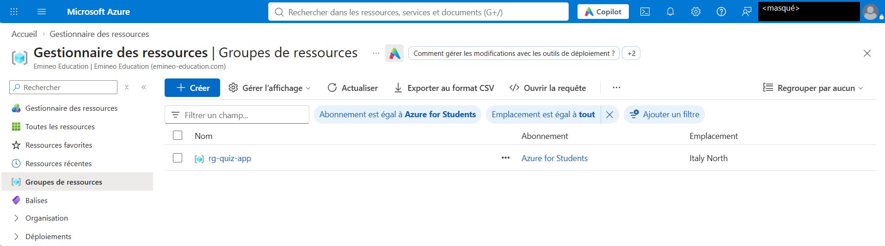
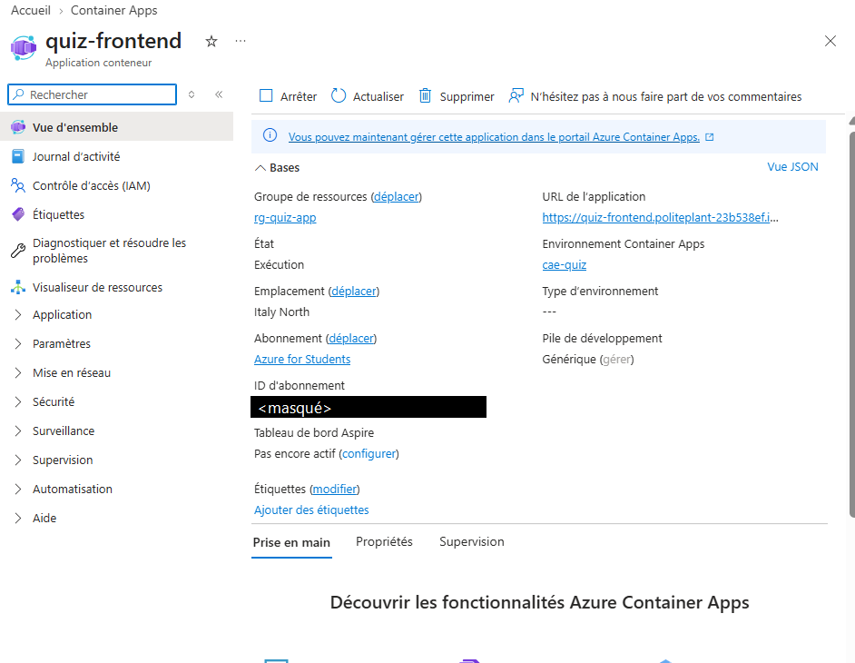
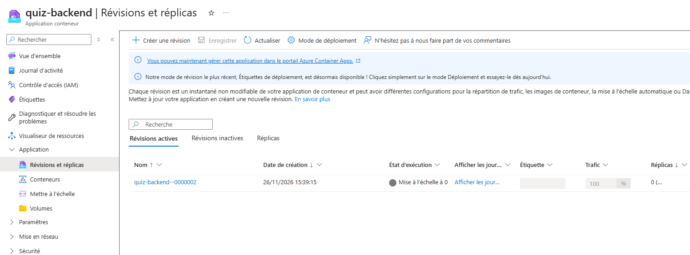
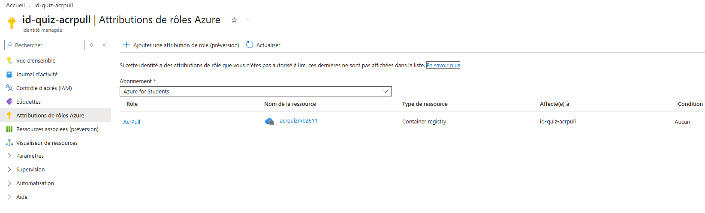

# J4 — Frontend et backend dans Azure Container Apps

**Date :** 26/11/2026
**Abonnement :** abonnement du projet (Mathis), région `italynorth`.
**Code déployé :** commit `832fb4c` (PR #10), images v2 durcies.
**Commande :** `bash scripts/deploy.sh`

Identifiants d'abonnement remplacés par `<id>`. L'adresse IP publique du poste de test est masquée dans les logs.

---

## 1. Sortie du déploiement

```console
$ bash scripts/deploy.sh
[...]
==> Déploiement terminé (tag 832fb4c)
Frontend : https://quiz-frontend.politeplant-23b538ef.italynorth.azurecontainerapps.io
```

## 2. Ressources du groupe

```console
$ az resource list -g rg-quiz-app --query "[].{nom:name, type:type, region:location}" -o table
Nom                      Region
-----------------------  ----------
acrquizmb2611            italynorth     # registre (J3)
cae-quiz                 italynorth     # environnement Container Apps
workspace-rgquizappCWWL  italynorth     # Log Analytics de cae-quiz
id-quiz-acrpull          italynorth     # identité managée AcrPull
quiz-backend             italynorth
quiz-frontend            italynorth
workspace-rgquizappjIc0  italynorth     # Log Analytics orphelin du 1er environnement (voir §8)

$ az containerapp env show -n cae-quiz -g rg-quiz-app --query "{mode:properties.environmentMode, domaine:properties.defaultDomain, etat:properties.provisioningState}" -o table
Mode             Domaine                                                Etat
---------------  -----------------------------------------------------  ---------
ConsumptionOnly  politeplant-23b538ef.italynorth.azurecontainerapps.io  Succeeded
```

## 3. Configuration des deux applications

```console
$ az containerapp show -n quiz-backend -g rg-quiz-app --query "{image:..., externe:..., port:..., insecure:..., min:..., max:..., cpu:..., mem:...}" -o table
Image                                          Externe    Port    Insecure    Min    Max    Cpu    Mem
---------------------------------------------  ---------  ------  ----------  -----  -----  -----  -----
acrquizmb2611.azurecr.io/quiz-backend:832fb4c  False      3007    True        0      1      0.25   0.5Gi

$ az containerapp show -n quiz-frontend -g rg-quiz-app --query "{...}" -o table
Image                                           Externe    Port    Insecure    Min    Max    Cpu    Mem
----------------------------------------------  ---------  ------  ----------  -----  -----  -----  -----
acrquizmb2611.azurecr.io/quiz-frontend:832fb4c  True       8080    False       0      1      0.25   0.5Gi
```

| | Backend | Frontend |
|---|---|---|
| Ingress | **interne** : joignable seulement depuis l'environnement | **externe** : URL publique HTTPS |
| Port cible | 3007 (Express) | 8080 (nginx non-root) |
| HTTP accepté | oui (`allowInsecure`), car nginx l'appelle en `http://quiz-backend` | non : HTTP redirigé vers HTTPS |
| Réplicas | 0 à 1 (scale-to-zero) | 0 à 1 |

### Variables et secrets du backend

```console
$ az containerapp show -n quiz-backend -g rg-quiz-app --query "properties.template.containers[0].env[].{nom:name, secretref:secretRef, valeur:value}" -o table
Nom             Secretref       Valeur
--------------  --------------  ---------------------
DATABASE_URL    database-url
JWT_SECRET      jwt-secret
ADMIN_USERNAME                  admin
ADMIN_PASSWORD  admin-password
RESEND_API_KEY  resend-api-key
FROM_EMAIL                      <valeur non sensible>

$ az containerapp secret list -n quiz-backend -g rg-quiz-app --query "[].name" -o tsv
admin-password
database-url
jwt-secret
resend-api-key
```

Les 4 valeurs sensibles sont des **secrets ACA** référencés par `secretref:`. Elles ne sont ni dans l'image, ni dans git, ni dans GitHub : seulement dans `.env.azure` (local, ignoré par git) et dans l'application.

### Variable du frontend

```console
Nom          Valeur
-----------  -------------------
BACKEND_URL  http://quiz-backend
```

Elle est injectée dans `nginx/default.conf.template` au démarrage : c'est la même image qu'en local, seule la variable change.

## 4. Révisions

```console
$ az containerapp revision list -n quiz-backend -g rg-quiz-app --query "[].{revision:name, active:..., trafic:..., sante:..., etat:..., image:..., cree:...}" -o table
Revision               Active    Trafic    Sante    Etat               Image                                          Cree
---------------------  --------  --------  -------  -----------------  ---------------------------------------------  -------------------------
quiz-backend--24gyxxl  True      100       Healthy  RunningAtMaxScale  acrquizmb2611.azurecr.io/quiz-backend:832fb4c  2026-11-26T14:03:25+00:00

$ az containerapp revision list -n quiz-frontend -g rg-quiz-app [...] -o table
Revision                Active    Trafic    Sante    Etat               Image                                           Cree
----------------------  --------  --------  -------  -----------------  ----------------------------------------------  -------------------------
quiz-frontend--grfdb7o  True      100       Healthy  RunningAtMaxScale  acrquizmb2611.azurecr.io/quiz-frontend:832fb4c  2026-11-26T14:07:50+00:00
```

Chaque application a une révision active, saine, qui reçoit 100 % du trafic, avec l'image taguée par le SHA du commit.

## 5. Tests HTTP

```console
$ FQDN=quiz-frontend.politeplant-23b538ef.italynorth.azurecontainerapps.io

$ curl -sS -o /dev/null -w "HTTP %{http_code}  %{content_type}\n" https://$FQDN/
HTTP 200  text/html

$ curl -i https://$FQDN/health
HTTP/2 200
server: nginx/1.30.8
content-type: application/json; charset=utf-8
{"status":"ok"}

$ curl -sS -o /dev/null -w "HTTP %{http_code}\n" https://$FQDN/gestion-quiz
HTTP 200

$ curl -sS -o /dev/null -w "HTTP %{http_code} -> %{redirect_url}\n" http://$FQDN/
HTTP 301 -> https://quiz-frontend.politeplant-23b538ef.italynorth.azurecontainerapps.io/

$ curl -sS -o /dev/null -w "HTTP %{http_code}\n" https://quiz-backend.internal.politeplant-23b538ef.italynorth.azurecontainerapps.io/health
HTTP 404

$ curl -sS -o /dev/null -w "HTTP %{http_code}\n" -X POST -H 'Content-Type: application/json' \
    -d '{"username":"x","password":"y"}' https://$FQDN/api/admin/login
HTTP 401
```

| Test | Résultat | Ce que ça prouve |
|---|---|---|
| `GET /` | 200 | le frontend (nginx) sert le quiz construit par Vite |
| `GET /health` | **200 `{"status":"ok"}`** | nginx relaie `/health` jusqu'au backend **privé** : le chemin navigateur → frontend → backend fonctionne |
| `GET /gestion-quiz` | 200 | la page d'administration est servie |
| `http://` | 301 vers `https://` | l'ingress externe impose HTTPS |
| backend appelé depuis internet | 404 | le backend n'est **pas** exposé publiquement (ingress interne, FQDN en `.internal.`) |
| `POST /api/admin/login` (mauvais identifiants) | 401 | les routes `/api` atteignent Express, qui répond normalement |

Les routes qui utilisent PostgreSQL (`/api/users`, `/api/results`) répondent 500 tant que la base n'est pas branchée : `DATABASE_URL` est encore factice. La base Neon arrive en J5.

## 6. Logs

```console
$ az containerapp logs show -n quiz-backend -g rg-quiz-app --tail 20 --format text
2026-11-26T14:10:42.51134  Successfully Connected to container: 'quiz-backend' [Revision: 'quiz-backend--24gyxxl', ...]
2026-11-26T14:09:42.121843257Z Server running on port 3007

$ az containerapp logs show -n quiz-frontend -g rg-quiz-app --tail 15 --format text
2026-11-26T14:08:17.340757645Z 2026/11/26 14:08:17 [notice] 1#1: nginx/1.30.8
2026-11-26T14:08:17.341052346Z 2026/11/26 14:08:17 [notice] 1#1: start worker processes
2026-11-26T14:09:20.159375162Z 100.100.0.164 - - [26/Nov/2026:14:09:20 +0000] "GET / HTTP/1.1" 200 396 "-" "curl/8.18.0" "<ip masquée>"
2026-11-26T14:09:43.620084228Z 100.100.0.85 - - [26/Nov/2026:14:09:43 +0000] "GET /health HTTP/1.1" 200 15 "-" "curl/8.18.0" "<ip masquée>"
2026-11-26T14:09:43.705030717Z 100.100.0.85 - - [26/Nov/2026:14:09:43 +0000] "GET /gestion-quiz HTTP/1.1" 200 3075 "-" "curl/8.18.0" "<ip masquée>"
2026-11-26T14:09:51.124923230Z 100.100.0.85 - - [26/Nov/2026:14:09:51 +0000] "POST /api/admin/login HTTP/1.1" 401 31 "-" "curl/8.18.0" "<ip masquée>"
```

Les logs (stdout/stderr) des conteneurs sont collectés par l'environnement dans Log Analytics. `100.100.0.x` est l'adresse du proxy d'ingress (Envoy), et la dernière colonne est l'IP réelle du client (`X-Forwarded-For`).

## 7. Idempotence

Deuxième exécution du script, sur les ressources déjà existantes, après la fusion de la PR #10 (`HEAD` = `d98f776`) :

```console
$ bash scripts/deploy.sh
[...]
==> Déploiement terminé (tag d98f776)
Frontend : https://quiz-frontend.politeplant-23b538ef.italynorth.azurecontainerapps.io
```

**Aucune erreur.** Chaque étape a trouvé sa ressource (`show` réussi) et n'a rien recréé : groupe, ACR, environnement, identité, rôle AcrPull (pas de nouvelle attente de 60 s). Le backend et le frontend sont passés par la branche « mise à jour » (`secret set` + `update --image`).

```console
$ az containerapp revision list -n quiz-backend -g rg-quiz-app --all --query "[].{...}" -o table
Revision               Active    Trafic    Sante    Image                                          Cree
---------------------  --------  --------  -------  ---------------------------------------------  -------------------------
quiz-backend--24gyxxl  False     0         Healthy  acrquizmb2611.azurecr.io/quiz-backend:832fb4c  2026-11-26T14:03:25+00:00
quiz-backend--0000001  True      100       Healthy  acrquizmb2611.azurecr.io/quiz-backend:d98f776  2026-11-26T14:15:08+00:00

$ az containerapp revision list -n quiz-frontend -g rg-quiz-app --all --query "[].{...}" -o table
Revision                Active    Trafic    Sante    Image                                           Cree
----------------------  --------  --------  -------  ----------------------------------------------  -------------------------
quiz-frontend--grfdb7o  True      0         Healthy  acrquizmb2611.azurecr.io/quiz-frontend:832fb4c  2026-11-26T14:07:50+00:00
quiz-frontend--0000001  True      100       Healthy  acrquizmb2611.azurecr.io/quiz-frontend:d98f776  2026-11-26T14:15:50+00:00

$ az acr repository show-tags -n acrquizmb2611 --repository quiz-backend -o tsv
832fb4c
90beed9
cb2f7ea
d98f776

$ curl -i https://$FQDN/health
HTTP/2 200
{"status":"ok"}

$ az containerapp show -n quiz-backend -g rg-quiz-app --query properties.configuration.ingress.allowInsecure -o tsv
true
```

- **Nouvelle image, donc nouvelle révision.** Le tag `d98f776` a créé une révision par application. En mode *single*, 100 % du trafic a basculé sur la nouvelle révision dès qu'elle a été saine. L'ancienne est conservée avec 0 % de trafic, puis désactivée : elle reste disponible pour un retour arrière.
- **Changer un secret (`secret set`) ne crée pas de révision**, contrairement au changement d'image.
- **`allowInsecure` est toujours `true`** : le réglage est réappliqué à chaque lancement (correction de la PR #10).
- **`/health` répond toujours 200** après la mise à jour.

## 8. Problèmes rencontrés et corrections

| Problème | Cause | Correction |
|---|---|---|
| `.env.azure: line 4: $'\r': command not found` | `.env.azure` enregistré en CRLF. `.gitattributes` ne s'applique pas à un fichier ignoré par git | `sed -i 's/\r$//' .env.azure` ; VS Code réglé en LF |
| `.env.azure: line 17: syntax error near unexpected token 'newline'` | `FROM_EMAIL=Quiz App <noreply@example.com>` sans guillemets : `source` interprète `<` et `>` comme des redirections | guillemets autour de la valeur, modèle `.env.azure.example` corrigé (PR #10) |
| `(ExpressAllowInsecureNotSupported) Allow Insecure is not supported [...] on express environments` | l'extension `containerapp` 1.3.0b6 crée par défaut un environnement en mode **Express**, qui interdit `allowInsecure`. Sans ce réglage, nginx recevrait une 301 en appelant `http://quiz-backend` | `deploy.sh` crée l'environnement avec `--environment-mode ConsumptionOnly` et s'arrête si un environnement Express existe. L'environnement Express a été supprimé puis recréé (PR #10) |
| `unable to pull image using Managed identity [...]` au premier déploiement dans le nouvel environnement | délai de prise en compte de l'identité managée par un environnement tout juste créé : le rôle AcrPull était attribué et l'image présente | relance de la mise à jour de l'image : succès sans autre changement |
| Deux espaces Log Analytics | le premier (`workspace-rgquizappjIc0`) appartenait à l'environnement Express supprimé, et la suppression d'un environnement ne supprime pas son espace de logs | ⚠️ à supprimer (coût faible, mais inutile) : `az monitor log-analytics workspace delete -g rg-quiz-app -n workspace-rgquizappjIc0 --yes` |

Voir aussi [`diagnostic.md`](diagnostic.md) : vraie dépendance de démarrage du backend.

---

## Bilan J4

| Critère | État |
|---|---|
| Deux applications tirées depuis l'ACR par identité managée (sans mot de passe) | ✔ |
| Frontend public en HTTPS, backend privé | ✔ ingress externe / interne |
| `/health` = 200 via le frontend | ✔ |
| Secrets dans ACA (`secretref:`), pas dans l'image | ✔ |
| Révisions et logs consultables | ✔ |
| Script relançable sans erreur | ✔ deuxième exécution sans erreur, nouvelles révisions `d98f776` (§7) |

---

## Captures du portail Azure

Identifiant d'abonnement et compte étudiant masqués.

| Capture | Ce qu'elle montre |
|---|---|
|  | groupe `rg-quiz-app` en Italy North, abonnement Azure for Students |
|  | `quiz-frontend` en exécution, URL publique, environnement `cae-quiz` |
|  | révisions du backend et répartition du trafic |
|  | `id-quiz-acrpull` : rôle **AcrPull** limité au registre `acrquizmb2611` |
