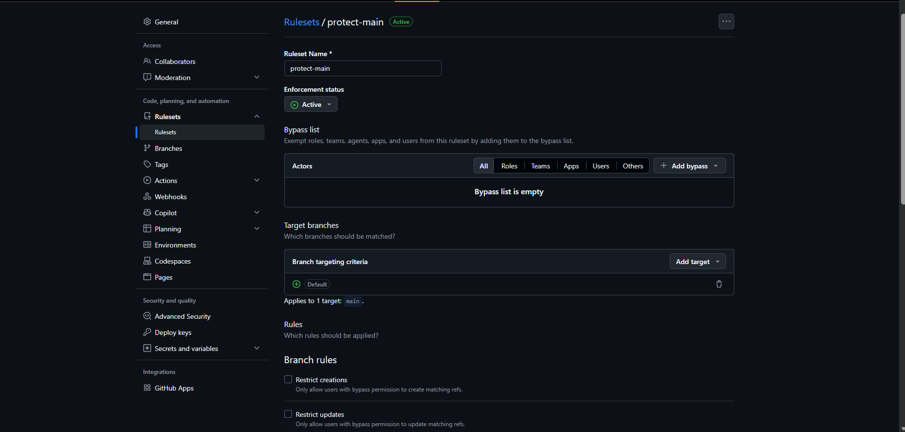
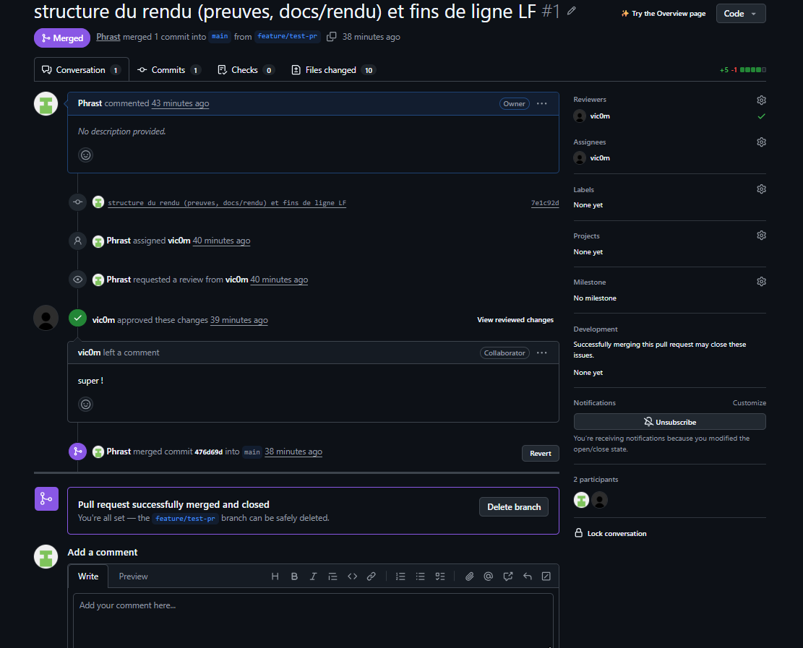

# J6 — Protection de `main` et Pull Request

**Date :** 26/11/2026 · **Dépôt :** fork `Phrast/eval-quiz-app`

## 1. Règle de protection active

La règle (*ruleset*) `protect-main` s'applique à `main`. Son statut est **Active**, et sa liste de contournement est **vide** : personne ne peut la contourner, pas même le propriétaire.

| Règle | État |
|---|---|
| Restrict deletions | ✔ |
| Block force pushes | ✔ |
| Require a pull request before merging | ✔ : 1 approbation requise, approbation annulée en cas de nouveau commit, conversations à résoudre |
| Require status checks to pass | activée à l'étape CI (voir [02-ci-pull-request.md](02-ci-pull-request.md)) |




## 2. Push direct sur `main` refusé

```console
$ git commit --allow-empty -m "test: push direct sur main (doit être refusé)"
$ git push origin main
remote: error: GH013: Repository rule violations found for refs/heads/main.
remote: - Changes must be made through a pull request.
 ! [remote rejected] main -> main (push declined due to repository rule violations)
```

## 3. PR vers le fork, approuvée puis fusionnée

La PR [#1](https://github.com/Phrast/eval-quiz-app/pull/1) envoie `feature/test-pr` vers le `main` du fork. Le binôme l'a approuvée, puis elle a été fusionnée.


