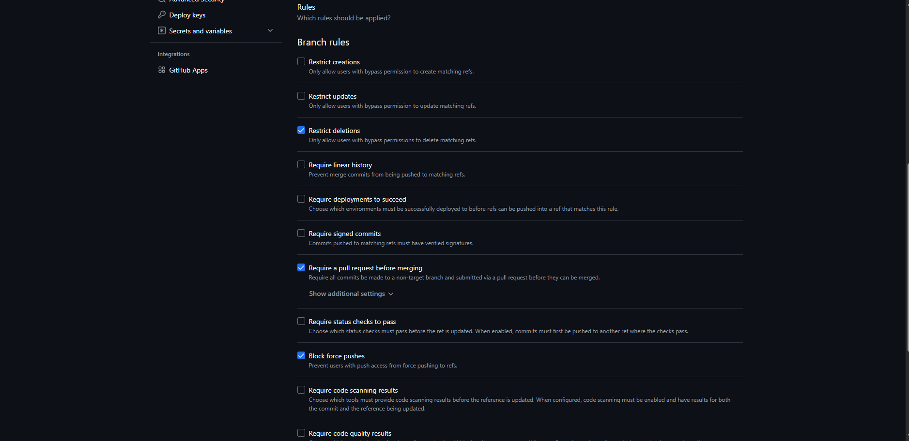

# J6 — Protection de la branche `main` et passage par Pull Request

**Date :** 26/11/2026
**Dépôt :** fork du groupe [`Phrast/eval-quiz-app`](https://github.com/Phrast/eval-quiz-app), forké depuis `franklin-tutorials/eval-quiz-app`

Objectif (doc 04, procédures B à D) : `main` ne doit plus accepter de modification directe. Tout passe par une Pull Request approuvée par l'autre membre du binôme.

---

## 1. Règle de protection `protect-main`

Créée dans *Settings → Rules → Rulesets*.

| Paramètre | Valeur | Effet |
|---|---|---|
| Enforcement status | **Active** | la règle est réellement appliquée (pas en mode « Evaluate ») |
| Bypass list | **vide** | personne ne peut contourner la règle, propriétaire du dépôt compris |
| Branche ciblée | branche par défaut (`main`) | « Applies to 1 target: main » |
| Restrict deletions | ✔ | `main` ne peut pas être supprimée |
| Block force pushes | ✔ | l'historique de `main` ne peut pas être réécrit |
| Require a pull request before merging | ✔ | toute modification de `main` passe par une PR |
| Approbations requises | ⚠️ À compléter : capture des paramètres avancés (*Show additional settings*) montrant le nombre d'approbations | une PR doit être approuvée par l'autre membre |
| Require status checks to pass | pas encore | sera activé à l'étape CI (J6-A), une fois connus les noms réels des contrôles (doc 04, B.5) |




---

## 2. Test : un push direct sur `main` est refusé

Un commit vide (aucun fichier modifié) est créé sur `main`, puis poussé directement, sans PR :

```console
$ git commit --allow-empty -m "test: push direct sur main (doit être refusé)"
[main 7425c08] test: push direct sur main (doit être refusé)

$ git push origin main
Enumerating objects: 1, done.
Counting objects: 100% (1/1), done.
Writing objects: 100% (1/1), 217 bytes | 24.00 KiB/s, done.
Total 1 (delta 0), reused 0 (delta 0), pack-reused 0
remote: error: GH013: Repository rule violations found for refs/heads/main.
remote: Review all repository rules at https://github.com/Phrast/eval-quiz-app/rules?ref=refs%2Fheads%2Fmain
remote:
remote: - Changes must be made through a pull request.
remote:
To https://github.com/Phrast/eval-quiz-app.git
 ! [remote rejected] main -> main (push declined due to repository rule violations)
```

**Résultat :** GitHub refuse le push (`GH013`, « Changes must be made through a pull request »). La protection est donc **effectivement appliquée**, y compris au propriétaire du dépôt.

Le commit de test a ensuite été retiré du `main` local. Vérification avec `git status -sb` : `## main...origin/main`, aucun commit en avance.

---

## 3. Première Pull Request vers le fork : approuvée puis fusionnée

| Élément | Valeur |
|---|---|
| PR | [Phrast/eval-quiz-app#1](https://github.com/Phrast/eval-quiz-app/pull/1) : « structure du rendu (preuves, docs/rendu) et fins de ligne LF » |
| Branches | `feature/test-pr` → `main` **du fork** |
| Contenu | `.gitattributes`, `.gitignore`, dossiers `preuves/J0` à `J6` et `docs/rendu` (10 fichiers) |
| Revue | approuvée par l'autre membre du binôme (`vic0m`) |
| Fusion | par `Phrast`, commit de fusion `476d69d` |
| Contrôles CI | aucun pour l'instant (0 check) : la CI sera ajoutée à l'étape J6-A |


---

## 4. Difficulté rencontrée : PR ouverte par erreur vers le dépôt du formateur

- **Ce qui s'est passé :** une première PR a été ouverte vers `franklin-tutorials/eval-quiz-app` (#26) au lieu de notre fork. Elle a été **fermée sans fusion** et ne contenait que la structure du rendu, sans aucun secret.
- **Cause :** sur un fork, le bouton *Contribute*, le bandeau *Compare & pull request* et le lien affiché après `git push` présélectionnent le dépôt d'origine comme destination.
- **Correction appliquée :** les PR sont désormais créées via `https://github.com/Phrast/eval-quiz-app/compare/main...<branche>`, en vérifiant *base repository = Phrast/eval-quiz-app* avant de valider.
