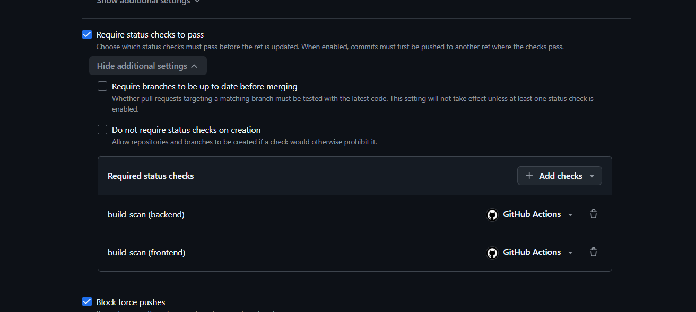
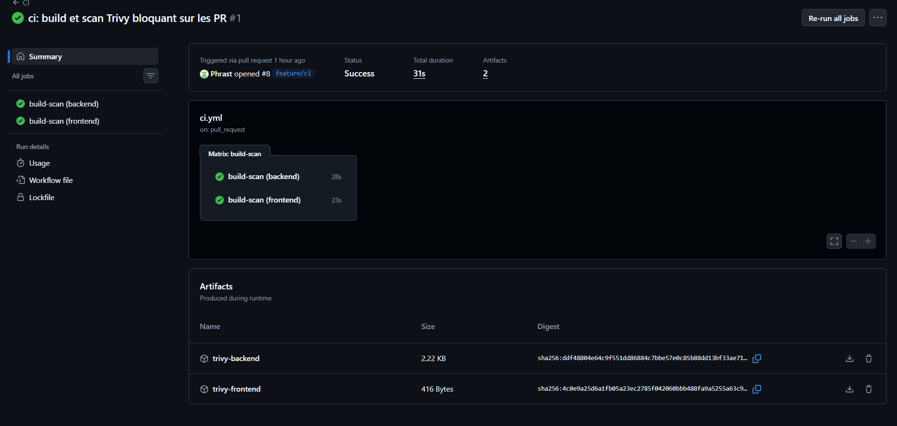
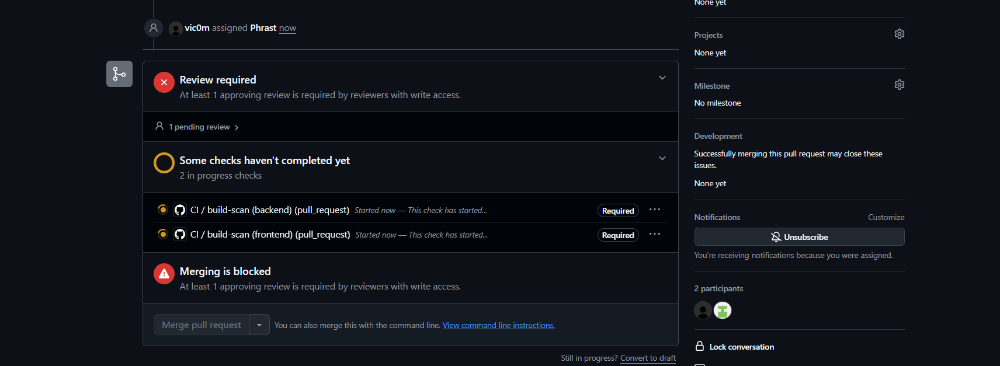
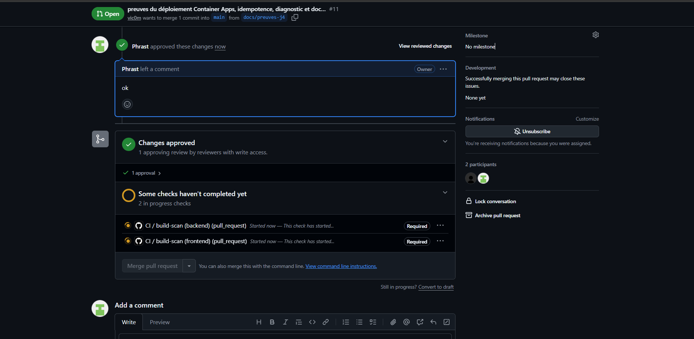
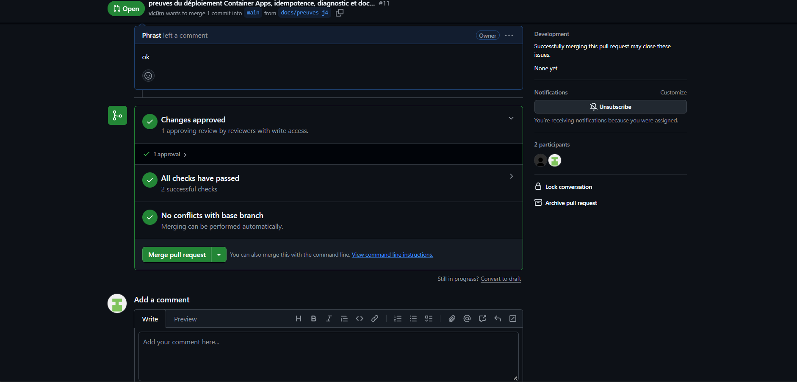
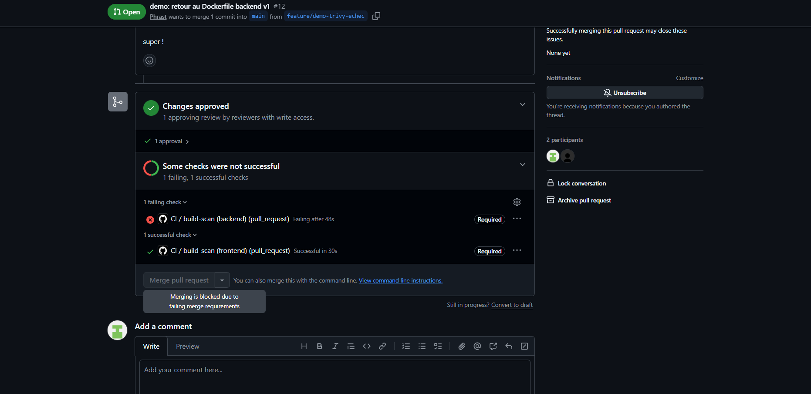
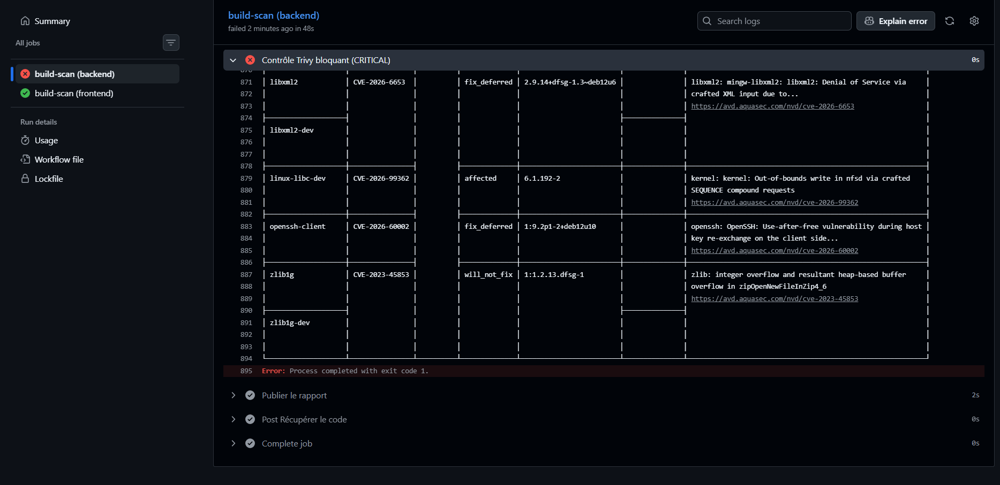

# J6-A — CI sur les Pull Requests

**Date :** 26/11/2026 · **Workflow :** [`.github/workflows/ci.yml`](../../.github/workflows/ci.yml)

## Fonctionnement

| Élément | Choix |
|---|---|
| Déclencheur | toute PR vers `main` (`pull_request`) |
| Jobs | `build-scan (backend)` et `build-scan (frontend)`, en parallèle. Chacun construit l'image, publie un rapport Trivy HIGH/CRITICAL en artefact, puis lance le contrôle bloquant |
| Contrôle bloquant | `trivy image --severity CRITICAL --exit-code 1` : une seule CRITICAL fait échouer le job. Aucun `continue-on-error` |
| Sécurité | aucun secret, droits en lecture seule (`contents: read`). Trivy 0.76.2 est épinglé par digest, et les actions GitHub par SHA de commit |

## Contrôles obligatoires avant la fusion

Les deux contrôles sont obligatoires dans la règle `protect-main`, en plus d'une approbation.

## CI réussie : la fusion devient possible

**PR [#8](https://github.com/Phrast/eval-quiz-app/pull/8)** (ajout de la CI) : exécution réussie, et rapports Trivy publiés en artefacts.

**PR [#11](https://github.com/Phrast/eval-quiz-app/pull/11)** : la fusion reste bloquée tant que la revue et les contrôles ne sont pas validés. Elle devient possible une fois la PR approuvée et les deux contrôles verts.

## Démonstration contrôlée : CI en échec, fusion bloquée

**PR [#12](https://github.com/Phrast/eval-quiz-app/pull/12)** : retour volontaire à l'ancien `backend/Dockerfile`, celui de l'image `node:22` complète (20 CRITICAL au scan J2).

- `build-scan (backend)` échoue : le contrôle Trivy trouve des CRITICAL et sort avec le code 1.
- `build-scan (frontend)` reste vert.
- La PR est **approuvée**, mais la fusion reste **bloquée** (« Merging is blocked due to failing merge requirements »).
- La PR a été fermée sans fusion. L'image vulnérable n'a été construite que sur la machine jetable de GitHub Actions : elle n'a **jamais été publiée** dans un registre.

