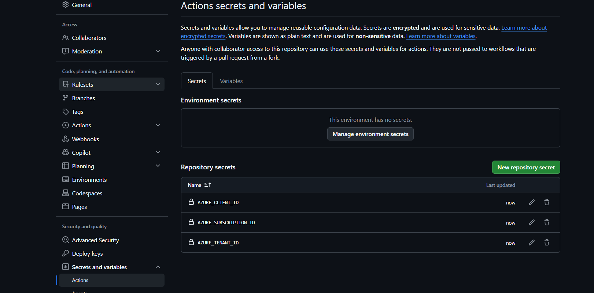
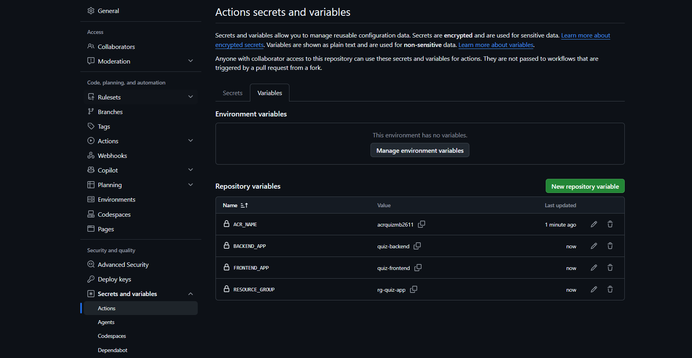
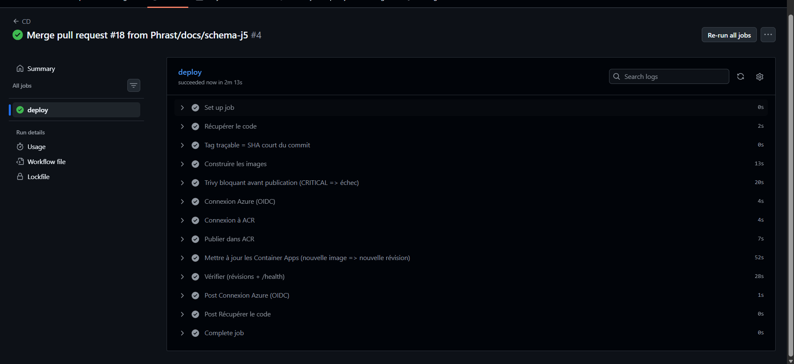
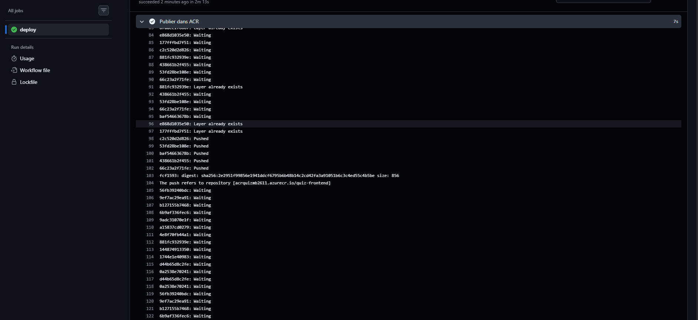
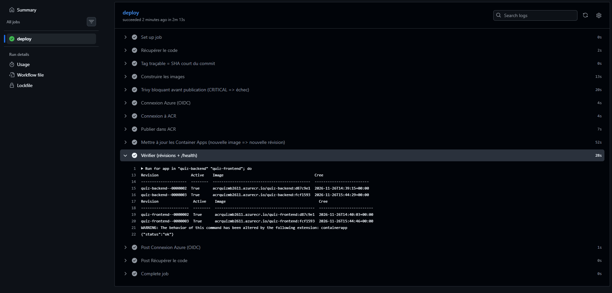

# J6-B — CD après fusion dans `main`

**Date :** 26/11/2026 · **Workflow :** [`.github/workflows/cd.yml`](../../.github/workflows/cd.yml) · **Exécutions :** [Actions → CD](https://github.com/Phrast/eval-quiz-app/actions/workflows/cd.yml)

## Fonctionnement

| Étape | Rôle |
|---|---|
| Déclencheur | `push` sur `main`. Comme `main` n'accepte que des PR, la CD ne se lance qu'**après une fusion**, jamais sur une PR |
| Tag des images | SHA court du commit (ex. `fcf1593`) : on sait exactement quel code tourne |
| Build + Trivy | les images sont reconstruites puis scannées : une CRITICAL arrête tout avant publication. Cette étape a lieu **avant** la connexion à Azure, donc aucun accès Azure n'est présent pendant le scan |
| Connexion Azure (OIDC) | GitHub fournit un jeton signé, qu'Azure échange contre un accès temporaire. Aucun mot de passe n'est stocké dans GitHub |
| Publication | `docker push` vers ACR : `acrquizmb2611.azurecr.io/quiz-backend:<sha>` et `quiz-frontend:<sha>` |
| Déploiement | `az containerapp update --image …:<sha>` crée une nouvelle révision de chaque application |
| Vérification | liste des révisions, puis appel de `/health` |

L'identité de déploiement a des droits minimaux : AcrPush sur l'ACR seulement, Contributor sur le groupe `rg-quiz-app` seulement. Son jeton n'est délivré qu'aux exécutions sur `main`.

## Configuration GitHub

3 secrets (identifiants Azure, dont GitHub n'affiche jamais les valeurs) et 4 variables (noms des ressources).

## Exécution après la fusion de la PR #18

Toutes les étapes sont vertes :

Les images sont publiées dans ACR avec le tag `fcf1593`, le SHA du commit de fusion :

Les nouvelles révisions `quiz-backend--0000003` et `quiz-frontend--0000003` utilisent l'image `fcf1593`. Les révisions précédentes utilisaient `d87c9e1`, déployée par `deploy.sh` à l'étape J4. `/health` répond `{"status":"ok"}` :

## Difficulté rencontrée

Les premières exécutions ont échoué à la connexion Azure :

- **`AADSTS700213`** : GitHub présente un *subject* qui contient les identifiants numériques du propriétaire et du dépôt (`repo:Phrast@98549218/eval-quiz-app@1472866739:ref:refs/heads/main`). L'identifiant fédéré a été mis à jour en conséquence.
- **`AADSTS700211`** : l'*issuer* avait un `/` final en trop. Il a été corrigé en `https://token.actions.githubusercontent.com`.
